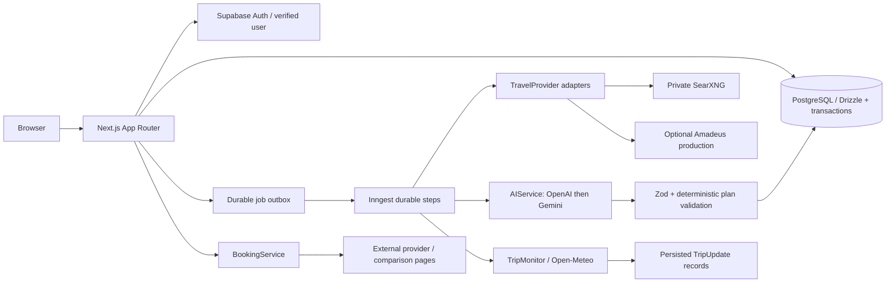

# Architecture

## Boundaries

- `domain.ts`: structured requests, preferences, offers, days, items, bookings and plan validation. Monetary values are integer cents for supported two-decimal currencies.
- `server/auth.ts`, `server/supabase.ts`, middleware: Supabase cookie refresh and server-verified identity. No production test-login route or trusted client-supplied user IDs.
- `server/schema.ts`, `server/store.ts`: typed schema, ownership checks, transactional writes, consistent reads, optimistic versions and immutable snapshots. SQL migrations are checksum-verified under an advisory lock.
- `providers/`: normalized provider interfaces; SearXNG discovery has `price=null`, `availability=unknown`. Amadeus production offers can contain quotes. Source-specific data stays in metadata.
- `ai/`: structured provider calls and targeted mutation application. Provider content is untrusted input. Validating an AI response precedes every database mutation.
- `booking/`: initiation returns a discriminated redirect/checkout result. Only external redirects are implemented. No payment details are collected; confirmation is explicitly manual.
- `server/jobs.ts`, `server/workflows.ts`: database outbox, per-user/request concurrency limits, durable steps, lease fencing and at-most-three crash recoveries. Generated output and job completion commit in one transaction.
- `monitoring/`: forecast checks and update creation; scheduling is in the workflow/store layers, not the weather logic.
- sharing: random 256-bit tokens, SHA-256 at rest, expiry and explicit public projections. Public links are read-only and never include confirmation email/number, paid price or private item notes.

## Data and state

Users own preferences, requests and trips. A trip has normalized days/items, provider offers, bookings, versions, updates and a revocable share link. Versions contain immutable structured snapshots. Reads use a repeatable-read transaction so the header and timeline describe one committed version.

Edits preserve IDs for unchanged/replaced items. New items get server-generated UUIDs. A write locks the owning trip, checks the expected version, rejects item IDs belonging to another trip, validates prices/timing/budget/references, and prevents changes to active booking items. Edits reset approval; bookings remain private records tied to stable items.

All writes require a verified session and matching `Origin`. Bodies are bounded while streamed. Shared PostgreSQL counters bound expensive requests. Provider requests have deadlines; errors returned to clients never include keys or raw provider bodies.

## Extension points

Add an official affiliate API by implementing `TravelProvider` and registering it. A provider with actual rates supplies integer prices and a safe booking URL; a discovery adapter leaves price null. Future exact-inventory checkout or Reap integration belongs in `BookingService`, not AI output. Providers must not manufacture confirmation, prices or availability.

Add monitoring sources by implementing `TripMonitor`. Official closure/severe-weather feeds and notifications require their own licensed source/delivery adapters; current in-app weather updates do not claim to cover them.

## Operational constraints

SearXNG is persistent infrastructure, separate from serverless Next.js. Inngest stores job-step data, so include it in the privacy/subprocessor review. Supabase holds application data; its public Data API is denied by default. Pool connections are bounded per process; use Supavisor and size the database/worker concurrency for the deployment.
